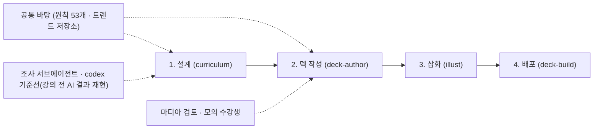
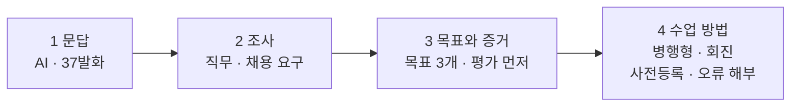
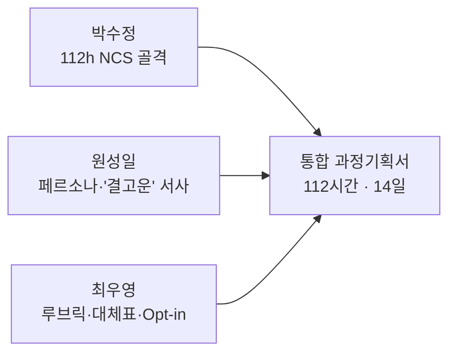
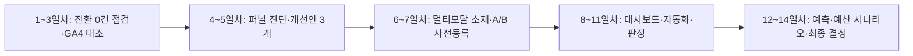

# 멀티모달 AI 그로스 마케팅 과정 설계

세 설계안의 비교와 통합

  박수정 · 원성일 · 최우영

---
layout: default
---

# 제안 분석부터 교안 초안까지

공통 출발점은 광고 최적화, 성과 분석·개선안, GA4·Looker+AI, GA4 광고 분석, 멀티모달 A/B, 데이터 시각화, 예측·시뮬레이션 7개 주제였습니다.

| 다루는 것 | 다루지 않는 것 |
| --- | --- |
| 제안 분석, 수강생 문제, 학습 요구 | 교안 검수와 최종본 |
| 강의 전략, 커리큘럼 설계 | LMS와 강의 지원 에이전트 |
| 교안 초안, 스킬·에이전트 형태 | |

<Callout title="발표 순서">
  1부 각자의 설계 과정 · 2부 비교 · 3부 통합 순으로 진행합니다.
</Callout>

<!--
- 공지 범위(제안 분석, 수강생 문제, 학습 요구, 강의 전략, 커리큘럼 설계, 교안 초안, 스킬·에이전트 형태)에 맞춰 구성했습니다.
- 같은 7줄 편성표를 받고도 AI와 일하는 방식에 따라 서로 다른 강점을 가진 기획서가 나왔다는 도입 흐름입니다.
-->

---
layout: default
---

# 설계안별 출발점과 수업 시간

| | 출발점 | 수업 시간 |
| --- | --- | --- |
| 박수정 | 고용24 공개 과정(REF-031) 기준 채택 | 112시간 독립 과정 (이론 38 · 실기 74) |
| 원성일 | 편성표 일곱 줄(800시간 과정 안의 한 교과)과 페르소나 | 112교시, 15일 (약 93시간) |
| 최우영 | 강사와 질문 문답(37발화)으로 정한 수업 목적 | 80시간 (월·수·금 10회) |

<Callout title="핵심 대비">
  똑같은 7줄 편성표에서 출발했지만, AI와 일하는 방식에 따라 3개의 전혀 다른 기획서가 나왔습니다.
</Callout>

<!--
- 원성일 안의 약 93시간은 비교 문서 3종이 112교시에 50분을 곱해 환산한 값입니다.
-->

---
layout: section
---

# 01
각자의 설계 과정

---
layout: default
---

### 1부 · 박수정
# 참고 과정과 수업 근거

예비·초급 마케터에게 필요한 **광고 성과 분석과 개선 제안**을 중심으로 자료를 골랐습니다.

<ProcessFlow :steps="[
  { title: '공개 과정 비교', detail: '고용24에서 AI·마케팅·데이터 분석이 함께 있는 교과를 찾아 수업 범위를 정했습니다.' },
  { title: '논문·공식 자료 조사', detail: '광고 효과 측정과 A/B 실험 연구, GA4 공식 문서와 공개 데이터를 검토했습니다.' },
  { title: '학습서·워크북 제작', detail: '출처별로 수업에 쓸 내용과 해석 한계를 기록하고 가상 데이터 실습을 만들었습니다.' },
]" />

**반영 예시**　Gordon 외(2019)의 광고 효과 연구를 참고해, 관찰 성과표로 캠페인을 비교하고 소재 효과는 별도의 가상 무작위 실험에서 해석하도록 했습니다.

<!--
- 시스템 매뉴얼 1~4쪽의 수집·정리 절차를 그로스 마케팅 과정에 적용했습니다. 공개 교과편성표에 AI·마케팅·데이터 분석이 함께 있는지를 기준으로 REF-031~033을 비교하고 REF-031을 참고 과정으로 골랐습니다. 이 교과에는 GA4·Looker Studio 분석, 시각화, A/B 실험이 포함됩니다.
- REF-031 5회차의 13개 교과 시간 합계는 800시간이고, 동명 교과는 112시간입니다. 참고 과정은 NCS 미적용입니다. 이 발표의 112시간 독립 과정은 해당 교과의 범위와 시수를 참고해 별도로 설계했습니다.
- 논문·학술 논평 7건과 공식 문서·공개 데이터 안내 12건을 채택 주제와 연결했습니다. 예시는 관찰 추정과 무작위 광고 실험을 비교한 Gordon 외(2019), 근거 목록 P01입니다. 원문 위치와 수업 활용 제안, 해석 한계를 분리해 기록했습니다.
-->

---
layout: default
---

### 1부 · 박수정
# 직무 기준으로 편성한 교과와 실습

최종 과제는 **광고 성과를 근거로 다음 집행안을 제안하는 일**입니다.

<ProcessFlow :steps="[
  { title: 'NCS 능력단위 선정', detail: '마케팅 성과 관리 등 목표 직무에 필요한 단위를 골라 수행준거를 확인했습니다.' },
  { title: '교과·차시 편성', detail: '교과별 시간을 정하고, 각 주제를 이론과 실습 차시로 나눴습니다.' },
  { title: '실습과 제출물 설계', detail: '차시마다 사용할 데이터와 학생이 할 일, 제출할 자료를 정했습니다.' },
]" />

**설계 예시**　‘성과 지표 선정’을 광고 지표 차시에 연결했습니다. 학생은 가상 광고 데이터로 지표 정의표를 작성한 뒤, 다음 차시에서 캠페인 성과를 비교합니다.

<!--
- 시스템 매뉴얼 4~5쪽의 교과 시간, 목차, 재사용·신규 판단과 실습 연결 순서를 따랐습니다. 마케팅 전략 기획·고객관리 NCS PDF 2종의 12개 단위 중 마케팅 성과 관리, 고객데이터 분석, 마케팅 전략 계획 수립을 골랐습니다. GA4·Looker Studio·A/B 실험 등은 비 NCS 교과 시간에 두었습니다.
- 112시간을 6개 교과로 배분했습니다. 이론 38시간·실습 74시간, NCS 64시간·비 NCS 48시간입니다. 학습 주제 23개를 각각 이론·실습으로 나눠 목차 46개에 배치했습니다.
- 대표 예시는 마케팅 성과 관리 수행준거 1.1(마케팅전략기획 PDF 73쪽)입니다. M1-1에서 분자·분모·기간을 정의하고 M1-2에서 R1 가상 성과표를 비교합니다. 클릭률은 캠페인 A 4.0%, B 3.0%이고 구매당 광고비는 A 15,000원, B 10,000원입니다.
- M4에서는 멀티모달 소재의 차이를 비교해 요소 하나만 바꾸는 실험을 설계합니다. 별도 가상 무작위 실험 R6의 7일 구매율은 기존 문구 4.0%(320/8,000명), 새 문구 4.8%(384/8,000명)입니다. 차이는 +0.8%p, 95% 정규근사 신뢰구간은 +0.16~+1.44%p입니다.
- Instructor Studio의 S5에는 실습 23개와 로컬 강사 데모 기준점 3개가 연결돼 있습니다(2026-11-18 revision 71). 실제 광고 집행과 클라우드 공개는 확인이 필요합니다.
-->

---
layout: default
---

### 1부 · 박수정
# 교안 초안과 제작 에이전트

**lesson-author**는 공통 차시 파일을 기준으로 단계를 나눠, 수정이 필요한 단계만 다시 실행할 수 있게 만들었습니다.

<ProcessFlow :steps="[
  { title: '입력 정리·근거 연결', detail: '학습 대상·목표·시간을 정리하고, 원문에서 근거 위치를 기록합니다.' },
  { title: '차시 설계·초안 작성', detail: '학생이 보여 줄 결과를 먼저 정하고, 강사용 교안과 학생용 활동지를 만듭니다.' },
  { title: '자동 검사·강사 검토', detail: '파일·시수·출처를 검사한 뒤, 강사가 수업 내용을 검토하고 저장을 결정합니다.' },
]" />

**제작 예시**　클릭률을 설명하는 강사용 교안과, 분자·분모·집계 기간을 적는 학생용 지표 정의표를 만들었습니다. 두 초안은 자동 구조 검사를 통과했습니다. 강사 검토 전입니다.

<!--
- 시스템 매뉴얼 9~10쪽의 11~12절은 Studio 교안 생성기와 외부 코딩 에이전트가 사용하는 공유 교안 제작 스킬의 사용 시점을 설명합니다. 이 장의 예시는 공유 lesson-author로 만든 파일 초안입니다.
- 에이전트의 입력·근거·설계·작성·검토 모듈은 lesson.json을 공통 차시 파일로 사용합니다. evidence.md에는 근거, lesson.md에는 강사용 원고, practice.md에는 학생용 활동, review.md에는 검사 결과와 남은 질문을 기록합니다.
- M1-1-T 이론 3시간의 발표 자료는 HTML 14장과 PDF 14쪽입니다. M1-1-P 실습 1시간 활동지에는 클릭률의 원본 열과 분모가 0일 때의 처리, 해석 한계도 적게 합니다.
- 자동 검사는 필수 파일, 시간 합계, 출처 연결과 이론 발표 자료의 파일 형식을 확인했습니다. 강사의 내용 검토와 Instructor Studio S6 저장은 남아 있습니다.
-->

---
layout: default
---

### 1부 · 원성일
# 교안 제작 절차를 정리한 스킬

- **스킬 4개:** `lecture-curriculum`, `lecture-deck-author`, `lecture-illust`, `lecture-deck-build`
- **원칙 정본 1개:** 스킬들이 공통으로 따르는 원칙 53개
- **버전 이력:** 4일 동안 12개 버전을 거쳐 `v2.9.0`까지 고도화

<Callout title="목적">
  교안 한 벌을 뽑고 끝내지 않고, 강의를 만들 때마다 스킬을 고쳐 버전과 블라인드 시험 기록으로 남깁니다.
</Callout>

<!--
- 본 그로스 마케팅 과정 설계는 v2.7.0 기준으로 진행했고, 운용 과정 문서는 v2.8.0, 현재 최신 체계는 v2.9.0입니다.
-->

---
layout: default
---

### 1부 · 원성일
# AI 분석 보고서를 직접 검증하는 실습

| 국면 | 발견과 설계 전환 |
| --- | --- |
| 조사·페르소나 | 편성표가 800시간 과정 안의 112시간 교과임을 확인하고, 공고 15건·실사례 28건으로 **수강생 페르소나**(현직자가 드문 국비 취업준비생) 정의 |
| ‘결고운’ 시나리오 | 페르소나에 맞춰 모두가 공감할 실전 상황(**이틀 359,233원, 클릭 649건, 전환 0건 · "내일부터 광고를 끌까요?"**) 도입 |
| 강의 전 AI 결과 (기준선) | 강의를 듣기 전 수강생이 "광고 성과 분석하고 개선안 써줘"처럼 AI에게 그냥 부탁하는 상황을 codex로 재현했습니다. 강의를 들은 뒤의 결과는 이보다 나아야 합니다. |
| 뒤집힌 예상 | AI가 그림 숫자를 잘못 읽으리라 봤지만, 186줄 실무자 수준 보고서를 쓰고 선 8개 그림도 1% 안으로 읽었습니다. 못 채운 것은 그림에 없는 정의(UTM이 빠진 메타 유입)와 시험 전에 정할 주 지표였습니다. |

<Callout title="설계 전환">
  강의의 몫을 "AI로 분석하기"에서 "AI가 남긴 확인을 직접 수행하고 결정하기"로 옮겼습니다.
</Callout>

<!--
- 기준선 실행 조건: codex-cli 0.163.0, 지침 없는 빈 폴더, 마케터 취업준비생이 할 법한 요청 그대로, 한 번씩 실행. 원자료는 kyoans `mine/growth_marketing_ai/01_조사/그냥_시킨_결과.md`입니다.
- 기준선과 별도로 실습 자료를 만들며 잰 것: 판정 모델 16회 약 0.0008달러 대 생성 모델 한 번에 2만~6만 토큰(차이는 정확도가 아니라 형식과 비용), A/B 연습 데이터는 분모를 클릭당 구매로 바꾸면 유의하지 않아 표를 대상·중간 행동·구매로 나눴습니다.
-->

---
layout: default
---

### 1부 · 원성일
# 교안 제작 단계별 스킬과 에이전트의 역할

- 설계·실측 결과를 바탕으로 15일 실습 자산과 강사 노트를 구성했습니다.
- 공정(`브리핑.html`), 구성도(`구성도.html`), 운용 과정(`v2.8.0_운용과정.html`) 시각 자료 3종으로 문서화했습니다.

<!--
- 발표 현장에서 브리핑.html, 구성도.html, v2.8.0_운용과정.html 중 라이브 시연을 진행할지 사전에 정합니다.
-->

---
layout: default
---

### 1부 · 최우영
# 질의응답으로 정한 수업 목적

(feat. Wiggins, McTighe and Merrill)

1. AI와 2시간(37발화) 문답으로 수업 목적 구체화
2. 마케터 비전공 취업준비생의 직무와 채용 요구 조사
3. 학습목표 3개와 달성을 보여 줄 평가 증거를 먼저 설정
4. 수업 방법 4안(병행형 뼈대, 증례 회진, 사전등록, 오류 해부) 결합
5. 자가 점검으로 숨은 가정 5개와 과밀 회차 5개를 찾아 6개 조치 반영

<Callout title="설계 방식">
  활동보다 평가 증거를 먼저 고정해 "결과물이 같은지"가 아니라 "근거를 설명하는지"를 확인하도록 짰습니다.
</Callout>

<!--
- 질문과 답변 전체 과정이 slide_resource/최우영/멀티모달-AI-그로스-마케팅-수업-대화기록.md 에 기록되어 있습니다.
-->

---
layout: default
---

### 1부 · 최우영
# 학습목표와 공통 평가 기준

- 팀당 Meta 광고 예산 50만원으로 필요 표본을 직접 계산했습니다. (CTR 1.0%에서 1.5% 탐지 시 그룹당 노출 약 7,747회 필요)
- 직접 판정은 **클릭률 비교로 한정**하고, 전환율 판정은 샘플 데이터로만 연습하도록 설계했습니다.

| 판정 수준 | 실제 예시 답안 (A 1.4% 대 B 1.7%, p 약 0.10) |
| --- | --- |
| 보완 필요 | "B가 1.7%로 더 높으니 좋다" 또는 "p값 0.1이면 B가 좋을 확률이 90%다" |
| 통과 (이해함) | "p 약 0.10으로 기준(0.05)을 넘어 근거가 부족합니다. 표본 한계(최소 탐지 차이 약 0.5%p)를 밝히고 재실험을 제안합니다" |

---
layout: default
---

### 1부 · 최우영
# 멀티모달 AI 활용과 에이전트·교안 환경

| 영역 | 구현 내용 |
| --- | --- |
| 멀티모달 AI | Muse Spark(요소 후보), SAM 3.1(박스 면적 측정), Muse Image(변형 후 SAM 재측정 검증) · AI 해석은 가설로만 사용 |
| 운영 안전망 | 장애 대체표 10종, 열린 질문 16개, 근거 수준(사용자·조사·가정·미확인) 구분 |
| 저장소·에이전트 지침 | 기획서 규칙을 `AGENTS.md`로 문서화하고 오프라인 번들 폰트 기반 Slidev 교안 환경 구축 |

<!--
- AGENTS.md와 Slidev 저장소 세팅을 최우영 파트의 에이전트 지침 형태 성과로 포함할지 팀 확인이 필요합니다.
-->

---
layout: section
---

# 02
세 설계의 비교

---
layout: default
---

### 2부 · 비교
# 과정 유형·실습 데이터·학습 단위 비교

Claude · ChatGPT · Gemini 세 모델로 세 기획서를 교차 분석해 전제 차이를 먼저 분리했습니다.

| 전제 | 박수정 | 원성일 | 최우영 |
| --- | --- | --- | --- |
| 과정 유형 | 112시간 독립 과정 | 800시간 과정 안의 한 교과 | 독립 강의 (80시간) |
| 실습 데이터 | 합성 데이터 7종 (계정 미확정 전제) | 가상 브랜드 '결고운' 성과표 · GA4 데모 | 직접 집행 Meta 광고 (팀당 50만원) |
| 학습 단위 | 명시하지 않음 | 개인과 짝 검산 | 4인 1팀 프로젝트 |

<!--
- 비교 문서 3종은 A·B·C 이름표가 서로 달라(Claude A=박·C=최, Gemini A=최·C=박, ChatGPT cwy·psj·wsi) 이 발표에서는 사람 이름으로 통일했습니다.
-->

---
layout: default
---

### 2부 · 비교
# 수업 구성·평가 방식·멀티모달 AI 활용 비교

| 구분 | 박수정 | 원성일 | 최우영 |
| --- | --- | --- | --- |
| 수업 구성 | NCS 능력단위 3개 + 비NCS 3개 | 페르소나 · '결고운' 단일 사례 15일 | 학습목표 3개 · 평가 증거 역설계 |
| 평가 방식 | 산출물 목록 (문항은 후속 단계) | 마지막 날 3분 면접 확인 질문 3개 | 근거·이유·한계 루브릭과 예시 답 |
| 멀티모달 AI | 이미지·영상·음성 교란 요인 식별 | 차트·원자료 대조, 판정 모델 카피 검수 | Spark·SAM 면적 측정, Muse 변형 검증 |
| 스킬·에이전트 | `lesson-author` 5모듈 · Studio 연동 | 스킬 4개(v2.9.0) · 다중 검토 에이전트 | 대화형 역설계 · `AGENTS.md` 지침화 |

---
layout: default
---

### 2부 · 비교
# 설계안별 강점과 보완점

| | 강점 | 보완점 |
| --- | --- | --- |
| 박수정 | NCS 원문 근거, 112시간 시수 검산, 합성 데이터 7종 | 수업 서사와 평가 문항 공백 |
| 원성일 | 페르소나 기반 ‘결고운’ 서사, 실측으로 바꾼 설계, 스킬 체계 | 근거 표기·합격선 약함, 독립 운영 제약 |
| 최우영 | 근거·이유·한계 루브릭, 표본 계산, 장애 대체 안전망 | 광고 계정·Model API 외부 의존 높음 |

<Callout title="AI 3종 교차 비교 결론">
  Claude · ChatGPT · Gemini 세 모델 모두 "세 설계의 약점은 서로 겹치지 않는다"는 같은 결론에 수렴했습니다.
</Callout>

---
layout: section
---

# 03
하나의 통합안으로

---
layout: default
---

### 3부 · 통합
# NCS를 바탕으로 한 과정 통합 원칙

1. **`[박수정]`** 112시간 NCS(64h)와 비NCS(48h) 편성을 기본 뼈대로 삼습니다.
2. **`[원성일]`** 수강생 페르소나에 맞춘 ‘결고운’ 사례로 첫날 질문을 14일차에 다시 답합니다.
3. **`[최우영]`** 근거·이유·한계 루브릭, 결과물 합격 기준, 장애 대체표를 평가와 운영에 넣습니다.
4. **`[최우영]`** 실제 Meta 광고 집행은 환경이 확인될 때만 여는 선택 트랙(Opt-in)으로 분리합니다.

<!--
- 통합 기획서(결론_통합과정기획서.md) 본문 대조 결과 [cite: 1, 2, 3]은 1=최우영, 2=원성일, 3=박수정으로 확인되었습니다.
-->

---
layout: default
---

### 3부 · 통합
# ‘결고운’ 광고 사례로 연결한 교과 구성

| 구분 | 교과목 | 시간 |
| --- | --- | ---: |
| NCS (64h) | 광고 성과 측정·개선 (24) · 고객·캠페인 데이터 분석 (24) · 데이터 기반 마케팅 전략 (16) | 64 |
| 비NCS (48h) | 데이터 분석 도구 (20) · 멀티모달 A/B 실험 (16) · 예측·시뮬레이션 (12) | 48 |
| 합계 | 이론 38시간 + 실기 74시간 | 112 |

<Callout title="이중 실습 트랙">
  기본 경로는 가상·합성 데이터로 전원 완주를 보장하고, 계정과 GA4가 확인되면 팀당 50만원 Meta 실집행(Opt-in)을 병행합니다.
</Callout>

---
layout: default
---

### 3부 · 통합
# 결과물 통과 기준은 근거·판단 이유·한계

- **공통 루브릭:** 근거·이유·한계 중 하나라도 빠지면 보완 후 다시 제출합니다.
- **필수 결과물 6종 (개인 기여 기록 필수):** 측정 점검표, 개선 리포트, 대시보드, A/B 설계·판정서, 자동화 보고서, 예산 시나리오·제안서
- **14일차 3분 면접 확인 질문 3개:**
  1. "AI 보고서의 어느 숫자를 직접 확인했나요?"
  2. "B안 클릭률이 올랐는데도 도입을 보류한 이유는 무엇인가요?"
  3. "다음 주에 무엇을 바꾸고, 어떤 결과가 나오면 결정을 다시 검토할 건가요?"

<Callout title="대표 장애 대체 방안">
  광고 계정·결제 불가 시 기본 합성 CSV 경로로 전환하고, Model API 제한 시 사전 일괄 측정표와 범용 AI로 동일 과업을 수행합니다.
</Callout>

---
layout: default
---

# 과정 편성 확정과 첫 교안 제작

- **핵심 교훈:** 같은 7줄 편성표도 AI와 일하는 방식에 따라 행정 골격(박수정), 수업 서사·실측(원성일), 평가·운영 안전망(최우영)이라는 서로 다른 강점이 나왔고, 교차 비교를 거쳐 상호 보완적인 통합안으로 수렴했습니다.
- **남은 결정과 확인:**
  - 총 시수(112 / 약 93 / 80시간)와 과정 위치(독립 과정 / 800시간 내 교과)를 팀 회의에서 확정합니다.
  - Model API 한국 이용 가능 여부, Meta 광고 계정, GA4 권한은 개강 전 확인이 필요합니다.
  - 문서 상태인 통합 기획서를 공용 스킬·에이전트 지침으로 전환해야 합니다.

<Callout title="다음 단계">
  통합안 기준으로 교안 초안 한 차시를 직접 제작하고, 그 과정을 팀 공용 스킬로 남깁니다.
</Callout>
