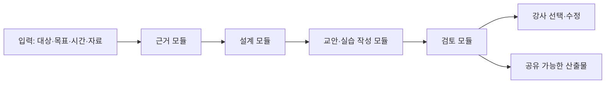

---
tags:
  - agent-package
  - agent/lesson-author
  - type/architecture
---

# 내 교안 제작 에이전트 설명

## 한 문장 설명

학습 목표와 근거 자료를 받아 **검토 가능한 교안·실습·평가 초안**을 만들고, 시간과 출처를 확인한 뒤 강사에게 선택권을 넘기는 코딩 에이전트다.

| 모듈 | 내 에이전트가 하는 일 | 사람이 확인하는 것 |
|---|---|---|
| 입력 | 한 차시의 대상·시간·목표를 정리 | 목표와 제약이 실제 수업과 맞는가 |
| 근거 | 자료 위치를 찾아 주장과 연결 | 출처가 실제로 내용을 뒷받침하는가 |
| 설계 | 평가 증거 → 활동 → 설명 순서로 시간표 작성 | 학습자가 할 행동이 가능한가 |
| 작성 | 강사용 교안과 학생 실습서 초안 생성 | 설명, 화면, 실패 대안이 쓸 만한가 |
| 검토 | 시수·참조·누락을 검사하고 질문 목록 작성 | 수정·채택·폐기 결정 |

## 왜 모듈로 나눴는가

한 번에 슬라이드까지 만들면 근거가 없는 설명과 실습 시간이 뒤늦게 드러난다. 이 에이전트는 `lesson.json`을 공통 계약으로 사용한다. 주제가 바뀌어도 자료 확인, 차시 설계, 작성, 검토 중 필요한 단계만 다시 실행할 수 있다. 팀원은 같은 산출물을 읽고 자기 에이전트로 검토하거나 덱을 제작할 수 있다.

## 60초 발표 원고

“제가 만든 교안 에이전트는 하나의 긴 프롬프트가 아닙니다. 먼저 대상·목표·시간을 입력받고, 근거 모듈이 자료의 정확한 위치를 기록합니다. 설계 모듈은 학생이 보여 줄 결과를 먼저 정한 뒤 실습과 설명을 배치합니다. 작성 모듈은 강사용 교안과 학생용 실습서를 만들고, 검토 모듈은 시간 합계와 출처 누락을 확인합니다. 모든 결과는 공통 JSON과 Markdown 파일로 남아서 팀원에게 전달할 수 있습니다. 마지막 선택과 과정 저장은 강사가 합니다.”
